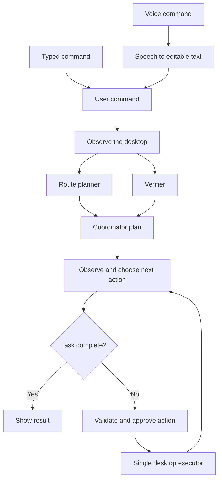

# Lite CU



The route planner and verifier run in parallel. Codex supplies the planning and action decisions using **GPT‑6.1 Sol or GPT‑6 Sol** and your existing ChatGPT sign-in. Desktop actions run one at a time, with a fresh observation after each. Stop cancels pending work at any point; Demo uses simulated models and a simulated desktop.

A small native Mac app for experimenting with voice-driven computer use, powered by **GPT‑6.1 Sol or GPT‑6 Sol through your existing Codex sign-in**. No API key is required for the Codex backend. An optional OpenAI API backend is also included.

Built with SwiftUI and Apple system frameworks. No Electron, Python runtime, server, or third-party package dependencies.

This is an early testing prototype. Planning assistants run concurrently; a single executor controls the foreground desktop. It does not provide independent background desktops or browser workers.

## Run on your Mac

Requires macOS 14+, a Swift 6 toolchain (Xcode or recent Command Line Tools), and a current Codex CLI for live model access.

```sh
git clone https://github.com/astro-msk/local_lite_cu.git
cd local_lite_cu
./scripts/run.sh
```

The script builds a release executable, creates and ad-hoc signs `dist/Lite CU.app`, and opens it. Run the `.app` bundle so macOS can associate permissions with Lite CU. `swift run LiteCU` alone is useful for development but is not the supported microphone/permission setup.

1. Click **Try a simulated browser task** to test the complete workflow without network calls, permissions, or desktop effects. The demo is a fixed Safari-search rehearsal regardless of the command text.
2. Open **Settings → Codex** and click **Check connection**. It should report that Codex is signed in with ChatGPT. This diagnostic does not make a model request.
3. Enable **Accessibility** and **Screen Recording** for Lite CU in macOS System Settings. Restart the app if macOS requests it. Permissions may need to be re-enabled after rebuilding an ad-hoc signed app.
4. Choose **Live**, enter a small task, and run. For example: “Open Safari and navigate to https://example.com.” Keep action approval enabled for the first experiments.
5. For voice, click the microphone, speak, then stop dictation. Review the transcript before running. macOS will request Microphone and Speech Recognition access.

Lite CU hides its window during live control and brings it forward for approval and the result. Keep the target app on the main display and avoid using the mouse or keyboard during a live run. **⌘⇧Esc** stops from another app once Accessibility is granted; **⌘.** stops while Lite CU is active. Quitting also cancels active work.

## Codex sign-in

Lite CU discovers the CLI bundled with ChatGPT/Codex before looking for a standalone installation. You can override the executable path in Settings. Authentication remains managed by Codex: the app does not read or copy tokens.

If the CLI is not signed in, run `codex login` with the same executable selected in Settings, then check the connection again. The backend requires a recent CLI supporting `exec --ignore-user-config`, `--ignore-rules`, `--ephemeral`, images, and structured output. Old Homebrew installations may not support these flags; the app fails rather than silently running with inherited tools. Bundled executable paths can change with app updates.

Each model request starts a bounded, read-only `codex exec` process in a private temporary directory. User configuration, repository instructions, MCP servers, shell execution, and other host tool integrations are disabled for those requests. Codex receives the command, current screenshot, plan, and compact action history and returns text or a JSON action proposal. The native app validates and executes it. Codex usage consumes the limits of the signed-in account; model availability depends on that account.

The optional **OpenAI API** backend uses `POST /v1/responses` with structured output. Save its API key in macOS Keychain, or launch with `OPENAI_API_KEY` set. GUI launches from Finder generally do not inherit shell environment variables.

## What works

- Typed commands and Apple speech recognition, with partial editable transcripts.
- GPT‑6.1 Sol and GPT‑6 Sol model selection.
- Two concurrent read-only planning assistants and a coordinator.
- A bounded observe/action/result loop, refreshing the screenshot after each action and after planning.
- Open installed apps by bundle ID, open HTTP(S) URLs, click/double-click, type Unicode text, send shortcuts, scroll at a specific point, wait, and observe.
- Main-display screenshots with explicit pixel-to-desktop coordinate mapping.
- A visible activity timeline, plan, result, permission status, and raw proposed action arguments.
- Per-action approval by default, cancellation, action limits, and repeated-action detection.
- Foreground/window identity checks before keyboard and pointer input, including returning from the approval UI.

The two planning assistants inspect the same snapshot; they do not have search tools and cannot operate the desktop. Turning them off reduces model calls.

## Limits and data handling

- Live mode sends the command and main-display screenshots to the selected model backend. Close unrelated sensitive windows before testing. This app runs locally; model inference is remote.
- Speech uses on-device recognition when available. Otherwise macOS may send audio to Apple; the app displays the active recognition mode. The app does not record audio files.
- Codex request files and screenshots are private temporary files removed at request completion. `--ephemeral` disables persisted Codex session rollouts; this is not a guarantee about service-side retention or CLI operational logs.
- Only the main display is controlled. Global mouse/keyboard events occupy your foreground session. Keyboard shortcut letters use ANSI physical key positions.
- Window changes and unexpected foreground-app changes abort input. Content can still change inside the same window between observation and action; this prototype is not a hardened automation sandbox.
- Model-marked sensitive actions require approval even when routine approvals are disabled. That classification is model-based, not a deterministic guarantee. There is no arbitrary shell or AppleScript action tool.
- A maximum of 1–30 actions per run and a 120-second timeout per model request bound execution. Stop prevents future actions; it cannot undo an input already sent.
- Each Codex step is a new process. A persistent app-server connection, accessibility element targeting, background browser workers, and resumable sessions are future improvements.

## Development and verification

```sh
swift build
./scripts/test.sh
./scripts/build-app.sh

# Optional live model smoke tests; use your Codex account limits.
swift run LiteCUCheck --codex
swift run LiteCUCheck --codex --vision
swift run LiteCUCheck --codex --gpt-6-sol
```

The tests use fake model/desktop implementations to cover approval, cancellation, action validation, limits, refreshed observations, and concurrent planning. The demo check exercises the full coordinator loop. The vision smoke test sends a generated test card rather than a desktop screenshot.

Initial verification on Apple Silicon/macOS 26: all 15 automated tests, native build, and demo UI passed; Codex structured text passed with both GPT‑6.1 Sol and GPT‑6 Sol, and synthetic-image input passed with GPT‑6.1 Sol. Microphone transcription and live OS input require user-granted permissions and a hands-on test; they are not claimed as end-to-end verified.

Source layout:

```text
Sources/LiteCU/       SwiftUI, app state, screen/input driver, speech, Keychain
Sources/LiteCUCore/   Model adapters, planner/action loop, JSON schema and validation
Sources/LiteCUCheck/  Demo and optional real Codex smoke checks
Tests/               Deterministic orchestration and validation tests
Resources/           App bundle metadata and permission descriptions
scripts/             Build, launch, and verification scripts
```

## Related projects and documentation

- [macOS Harness](https://github.com/browser-use/macos-harness): the closest reference for native Mac automation and accessibility-first, app-scoped actions.
- [Cua](https://github.com/trycua/cua): drivers, SDKs, and isolated desktops; useful when expanding beyond a small local app.
- [Browser Use](https://github.com/browser-use/browser-use): a potential independent browser worker.
- [Codex non-interactive mode](https://learn.chatgpt.com/docs/non-interactive-mode), [authentication](https://learn.chatgpt.com/docs/auth), and [GPT‑6 model guidance](https://developers.openai.com/api/docs/guides/latest-model?model=gpt-6.1-sol).

This implementation does not vendor code from those projects.
