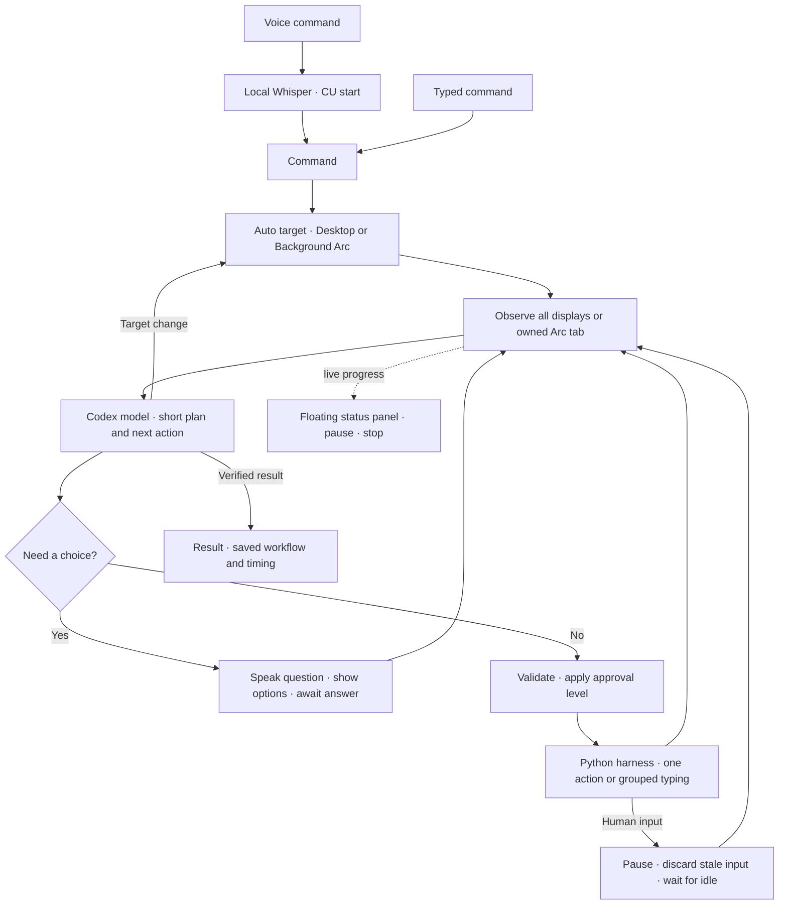

# Lite CU



A readable **Python Mac app** for voice-driven computer use, using **GPT‑6.1 Sol or GPT‑6 Sol through your existing Codex sign-in**. No API key is needed. The app owns planning, approval, input, observation, interruption handling, and run history. Codex is only the model transport.

This is the Python migration of the working Swift prototype. The Python code is in [`litecu/`](litecu/); the previous implementation remains in `Sources/` as a reference. Its setup and verification record are preserved in [Swift prototype notes](docs/swift-prototype.md). Python uses PySide6 for the interface, PyObjC for macOS frameworks, and local whisper.cpp for speech. It has a larger packaged footprint than the Swift version; it needs no server or Electron runtime.

## Run the Python app

Requires macOS 14+, Python 3.12+ (tested with 3.13), and an installed, signed-in Codex CLI for live mode.

```bash
uv sync --extra dev
./scripts/run-python.sh
```

Start with **Try demo**. Demo performs a fixed, simulated Calculator task, regardless of the command text. It never captures your screen, opens a microphone, calls a model, or sends desktop input.

For a standalone Mac app:

```bash
./scripts/build-python-app.sh
# Output: dist/python/Lite CU.app
```

Use the packaged app for live permission testing. Running `python -m litecu` from a terminal may attribute permissions to Python or the terminal rather than Lite CU. Quit the old Swift app before opening the Python app; both use the same permanent bundle identifier, `local.litecu.app`. The development build does not replace the old `dist/Lite CU.app`.

## What changed

| Request | Python implementation |
| --- | --- |
| Multiple screens | Captures a separate image for every active display. Each action names its display ID; coordinates account for negative origins, Retina scaling, and displays above/below each other. A window can span displays. Changed topology invalidates pending input. |
| Side status popup | Floating progress panel with current operation, target, duration, Pause/Resume, Stop, and return to workspace. It does not take keyboard focus during normal progress. |
| Automatic targets | **Auto** starts with a native app for app requests and Background Arc for websites. The model may change targets with a visible reason and a new observation. Explicit Desktop/Arc selection stays fixed. |
| Human interruption | A listen-only input monitor distinguishes physical input from the app's tagged events. It waits for idle and observes again; it never resumes an old click at stale coordinates. Mid-group interruptions discard remaining steps. |
| Stable permissions | Same bundle ID plus a build option for a persistent signing identity. Release builds refuse to proceed without one. Ad-hoc development builds still cannot guarantee permission persistence. |
| Faster execution | Plan and first action share one model request. Whole values such as `200` use a single text operation. Up to six same-surface typing/key steps may be grouped; clicks, navigation, and focus changes require another observation. |
| Shortcuts | ⌘K command palette, ⌘N new task, ⌘Return run, ⌘⇧Space dictation, ⌘⇧Esc stop. Workspace shortcuts are app-local; Desktop's input monitor also handles emergency stop globally while a task runs. |
| Spoken questions | Uncertain decisions pause and present choices plus a custom answer. With spoken questions enabled, macOS reads the question aloud. Start dictation to answer; the microphone never opens automatically. |
| Everyday usability | Persistent settings, light/dark themes, colored controls, approval preview, previous runs, per-step timings, and a visible pause/resume state. |

Speed still depends on model latency. Grouped input removes needless calls, but screenshot interpretation is not instantaneous. The app keeps a single executor to avoid conflicting actions.

Grouping is general desktop behavior, not a Calculator shortcut: for example, select the contents of a focused text field with `cmd+a`, replace the whole value, and optionally press Return as the last step. A group cannot continue after a focus-changing key, click, or navigation. Rejected proposals are explained to the model for correction before any input runs, with a bounded retry limit.

## Permissions and updates

Desktop needs **Accessibility**, **Screen Recording**, and access to monitor input for interruption handling. Checks are read-only at startup; the app does not reset permissions or edit the TCC database. Input Monitoring observes activity counters, not recorded keystrokes.

Background Arc needs **Automation → Lite CU → Arc**, plus Arc's **View → Developer → Allow JavaScript from Apple Events**. Arc actions operate only on a dedicated task window/tab and fixed, validated page operations. It cannot control password fields, cross-origin frames, file pickers, browser chrome, or native dialogs. It does not fall back to an unrelated user tab if its own tab disappears.

To preserve the identity macOS associates with permission grants across updates, build every release with the same code-signing identity and bundle ID, and install at a stable location:

```bash
export LITECU_SIGNING_IDENTITY='Developer ID Application: Your Name (TEAMID)'
./scripts/build-python-app.sh --release
```

**No signing identity was configured on the development Mac during migration.** The development build uses ad-hoc signing and may need permissions granted again after rebuilding. A stable identity is necessary for reliable updates, but macOS ultimately controls permission grants; the app cannot promise never to ask again. No certificate is generated or installed automatically. See [Apple's code-signing identity guidance](https://developer.apple.com/library/archive/technotes/tn2206/_index.html) and [PyInstaller's signing options](https://www.pyinstaller.org/en/latest/man/pyinstaller.html).

## Voice

```bash
./scripts/setup-whisper.sh
```

Click the green microphone, say the task, then **“CU start”** or **“CU start execution.”** After a pause, local Whisper transcribes it and the app starts the task. Without the trigger, review the transcript first. Spoken option numbers can answer a clarification after you explicitly start recording.

Whisper's model is stored outside the repository in `~/Library/Application Support/LiteCU/Models/ggml-small.en.bin`. Microphone audio is temporary and stays local. Live model calls send the task and desktop screenshots (all connected displays) or the dedicated Arc tab's text to the model through Codex.

## Read the code in this order

| File | Responsibility |
| --- | --- |
| [`litecu/core.py`](litecu/core.py) | The complete execution loop, target routing, approvals, clarification, batching, interruption recovery, and validation. |
| [`litecu/codex.py`](litecu/codex.py) | Replaceable Codex model transport. Private temporary files, no inherited tools/configuration, bounded output, timeout and cancellation. |
| [`litecu/geometry.py`](litecu/geometry.py) | Pure Python display-coordinate transforms and input activity counters. |
| [`litecu/desktop.py`](litecu/desktop.py) | ScreenCaptureKit observations, native app activation, mouse/keyboard actions, and physical-input monitoring. |
| [`litecu/arc.py`](litecu/arc.py) | Dedicated Arc tab ownership and background operations. Fixed page code is in `litecu/assets/`. |
| [`litecu/ui.py`](litecu/ui.py) | Workspace, workflow, floating status panel, command palette, settings, and history. |
| [`litecu/voice.py`](litecu/voice.py) | Explicit microphone capture, local Whisper transcription, voice triggers, and spoken questions. |
| [`litecu/ui_storage.py`](litecu/ui_storage.py) | Versioned preferences/history. Separate from the preserved Swift run history. |

Model-provided UI content is treated as untrusted. A model decision cannot execute arbitrary Python, shell commands, AppleScript, or JavaScript. The host validates declarative actions, applies the selected approval mode, and verifies subsequent observations. Full access skips action approvals but does not answer clarification questions. Stop cancels model work and prevents remaining grouped steps; already-completed actions are not undone.

## Verification

```bash
./scripts/test-python.sh
./scripts/build-python-app.sh
```

Python checks cover target routing, grouped typing, stale-screen recovery, physical-input interruption during planning, mid-group interruption, approvals, clarification, coordinate transforms, Arc script generation, and storage. Development status and live verification are recorded in [Python migration notes](docs/python-migration.md). Synthetic Codex tests are separate from actual desktop execution; a passing unit test is not a claim that every app or monitor arrangement has been tested live.

## Design references

[HeyClicky](https://www.heyclicky.com/) inspired the compact voice-first companion surface. [OpenClicky](https://github.com/prasanthsasikumar/openclicky) explores screen guidance and offline dictation; [LocalClicky](https://github.com/tanavc1/LocalClicky) explores local inference. [Cua](https://github.com/trycua/cua) provides a larger computer-use ecosystem. These are references, not dependencies; Lite CU keeps its own small, readable Python loop.
