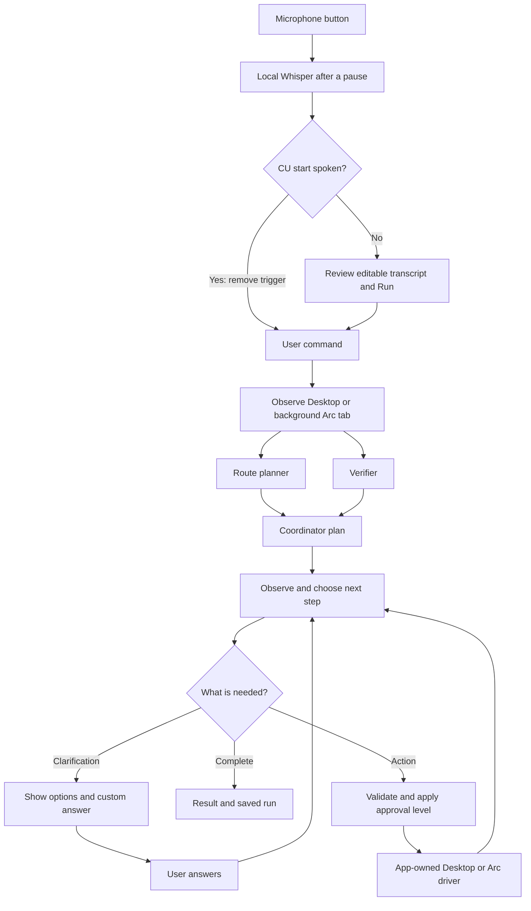

# Lite CU



The route planner and verifier run in parallel. Codex supplies the planning and action decisions using **GPT‑6.1 Sol or GPT‑6 Sol** and your existing ChatGPT sign-in. Desktop actions run one at a time, with a fresh observation after each. Stop cancels pending work at any point; Demo uses simulated models and a simulated desktop.

A small native Mac app for experimenting with voice-driven computer use, powered by **GPT‑6.1 Sol or GPT‑6 Sol through your existing Codex sign-in**. No API key is required for the Codex backend. An optional OpenAI API backend is also included.

Built with SwiftUI and Apple system frameworks, plus a local whisper.cpp executable and speech model for transcription. No Electron, Python runtime, or server is required.

This is an early testing prototype. Planning assistants run concurrently; a single executor runs each task. Choose Desktop for foreground Mac control, or Background Arc for page-level work in a dedicated Arc task tab while Lite CU stays visible.

## Who owns the harness?

**Lite CU owns the harness.** `AgentRunner` creates the parallel planning requests, coordinates the plan, validates proposed actions, requests approval, calls the native desktop driver, captures fresh observations, enforces limits, and stops work. Speech and all user-facing state also belong to the app.

`ModelClient.generate(...)` is the replaceable model boundary. `OpenAIClient` calls the Responses API; `CodexClient` invokes a restricted Codex CLI process using its existing sign-in and returns the same text/JSON output to the app. Codex's desktop, browser, shell, MCP integrations, and native subagents are disabled in this adapter. It is still a CLI runtime bridge rather than a raw HTTP inference call; the app never delegates its desktop execution loop to Codex.

The pipeline is defined in Swift, with [`AgentRunner.run(command:)`](Sources/LiteCUCore/AgentRunner.swift) as its entry point. The parallel planning requests and observe/action loop are both in that file. It publishes typed `WorkflowNode` updates, which [`WorkflowGraphView`](Sources/LiteCU/WorkflowGraphView.swift) renders as the live graph. [`AppModel.run()`](Sources/LiteCU/AppModel.swift) selects the backend and connects approvals, cancellation, and progress to the UI. [`SpeechController`](Sources/LiteCU/SpeechController.swift) supplies the editable transcript, [`ActionPolicy`](Sources/LiteCUCore/ActionPolicy.swift) validates decisions, and [`MacDesktopDriver`](Sources/LiteCU/MacDesktopDriver.swift) observes and acts on the Mac. [`ArcBrowserDriver`](Sources/LiteCU/ArcBrowserDriver.swift) owns background browser navigation and fixed DOM operations; Codex never executes those scripts itself.

## Run on your Mac

Requires macOS 14+, a Swift 6 toolchain (Xcode or recent Command Line Tools), and a current Codex CLI for live model access.

```sh
git clone https://github.com/astro-msk/local_lite_cu.git
cd local_lite_cu
./scripts/run.sh
```

The script builds a release executable, creates and ad-hoc signs `dist/Lite CU.app`, and opens it. Run the `.app` bundle so macOS can associate permissions with Lite CU. `swift run LiteCU` alone is useful for development but is not the supported microphone/permission setup.

1. Click **Try demo** to test the complete workflow without network calls, permissions, or desktop effects. The demo is a fixed Safari-search rehearsal regardless of the command text.
2. Open **Settings → Codex** and click **Check connection**. It should report that Codex is signed in with ChatGPT. This diagnostic does not make a model request.
3. Choose an execution target. **Desktop** needs Accessibility and Screen Recording in macOS System Settings. **Background Arc** needs Arc running, Automation permission for Lite CU → Arc, and Arc → View → Developer → Allow JavaScript from Apple Events. The Arc setup check verifies Automation. **Settings → Test example.com (live)** separately checks window creation, page reading, and a link click through the real Arc driver without using a model. This explicitly live diagnostic opens a separate test window even when the workspace is in Demo mode; Stop test cancels it. Permissions may need refreshing after rebuilding an ad-hoc signed app.
4. Choose **Live**, enter a small task, and run. For example: “Open Safari and navigate to https://example.com.” Keep action approval enabled for the first experiments.
5. For voice, install the local Whisper runtime/model as described below, then click the microphone and speak. A pause ends recording and starts local transcription; Stop also finishes recording. Say **“Open example dot com. CU start”** to run automatically after transcription. **“CU start execution”** also works. Without a trigger phrase, review the transcript and press Run. A trigger with no task does not run anything. Microphone permission is required; audio is not sent to a speech service.

**Desktop** hides Lite CU during control and returns for approval, clarification, and the result. Keep the target window entirely within one display and avoid using the mouse or keyboard during a Desktop run. **Background Arc** keeps Lite CU visible; creating the task window/tab may briefly bring Arc forward, but later navigation and DOM actions do not activate it. Avoid changing the agent’s dedicated tab while it works. **⌘⇧Esc** stops from another app once Accessibility is granted; **⌘.** stops while Lite CU is active. Quitting also cancels active work.

Use **New chat** for a fresh task and **Previous runs** to reopen a completed, stopped, or failed run without executing it again. The latest 100 finished runs are saved locally in `~/Library/Application Support/local.litecu.app/runs.json`, including commands, planning notes, action arguments, and results. Screenshots and model credentials are not stored in run history. Runs from older builds cannot be recovered because those builds did not save history.

If macOS shows Accessibility enabled but Lite CU still reports it unavailable after a rebuild, remove only Lite CU from the Accessibility list and add the current `dist/Lite CU.app` again. This refreshes the stale development-build entry; do not reset permissions for other apps.

## Local Whisper setup

```sh
./scripts/setup-whisper.sh
```

This one-time script installs whisper.cpp through Homebrew and downloads the checksum-verified English `small.en` model (about 488 MB). The model lives in `~/Library/Application Support/LiteCU/Models/ggml-small.en.bin`, outside the repository and app bundle. Later transcription works offline. No Python or ffmpeg runtime is needed.

The microphone button starts one capture, not an always-listening wake word. Recording ends after two seconds of quiet following speech, when you press Stop, or at 60 seconds. Whisper then transcribes locally. Only the completed transcript can trigger execution: **CU start** or **CU start execution**, case-insensitive. Whisper’s “see you start” spelling is also accepted at the beginning or end of the command. If the phrase is missed, the transcript stays editable and the Run button remains available. You can still use typed commands without installing Whisper.

## Codex sign-in

Lite CU discovers the CLI bundled with ChatGPT/Codex before looking for a standalone installation. You can override the executable path in Settings. Authentication remains managed by Codex: the app does not read or copy tokens.

If the CLI is not signed in, run `codex login` with the same executable selected in Settings, then check the connection again. The backend requires a recent CLI supporting `exec --ignore-user-config`, `--ignore-rules`, `--ephemeral`, images, and structured output. Old Homebrew installations may not support these flags; the app fails rather than silently running with inherited tools. Bundled executable paths can change with app updates.

Each model request starts a bounded, read-only `codex exec` process in a private temporary directory. User configuration, repository instructions, MCP servers, shell execution, and other host tool integrations are disabled for those requests. Codex receives the command, current screenshot, plan, and compact action history and returns text or a JSON action proposal. The native app validates and executes it. Codex usage consumes the limits of the signed-in account; model availability depends on that account.

The optional **OpenAI API** backend uses `POST /v1/responses` with structured output. Save its API key in macOS Keychain, or launch with `OPENAI_API_KEY` set. GUI launches from Finder generally do not inherit shell environment variables.

## What works

- Typed commands and local Whisper transcription, with an editable final transcript and spoken “CU start” execution trigger.
- White default appearance, optional Dark/System themes, and a matching native app icon.
- Consistent button colors: blue for running, green for voice, yellow for approval, and red for stopping.
- GPT‑6.1 Sol and GPT‑6 Sol model selection.
- Two concurrent read-only planning assistants and a coordinator.
- A bounded observe/action/result loop, refreshing the screenshot after each action and after planning.
- Open installed apps by bundle ID, open HTTP(S) URLs, click/double-click, type Unicode text, send shortcuts, scroll at a specific point, wait, and observe.
- Screenshots of the display containing the foreground window, with explicit pixel-to-desktop coordinate mapping.
- Background Arc navigation, visible DOM element clicks, text entry, and page scrolling without desktop input.
- Clarification choices and custom answers that resume the same run, including in Full access mode.
- A live vertical workflow graph with connected planning cards, action outcomes, observations, inline approvals, and an inspectable completed path.
- Per-step elapsed seconds/minutes and total wall-clock time, including time waiting for approval or clarification; saved runs preserve these measurements. Older runs without timing metadata do not invent durations.
- A Previous runs tab with locally saved workflow history and a New chat button for fresh tasks.
- Compact session and approval controls, permission readiness, and exact proposed action arguments.
- Three approval levels, an isolated approval preview, cancellation, action limits, and repeated-action detection.
- Foreground/window identity checks before keyboard and pointer input, including returning from the approval UI.

The two planning assistants inspect the same snapshot; they do not have search tools and cannot operate the desktop. Turning them off reduces model calls.

## Approval levels

- **Ask every action** (default): review each desktop change before it runs.
- **Ask for sensitive actions**: routine actions run automatically; model-marked sensitive actions pause for approval.
- **Approve all (Full access)**: all supported actions run without an app approval prompt, including actions the model marks sensitive. macOS permissions, action validation, limits, and emergency stop still apply.

Clarifications are separate from action approvals: when intent is ambiguous, the agent asks a question with 2–4 options and a custom-answer field, even in Full access. Continue resumes the same run after a fresh observation; Cancel stops it. Up to three clarification rounds are allowed, without spending the action budget. Answers are retained in the workflow history.

The approval preview uses a sample action and never calls the desktop driver. Approving or rejecting the sample only demonstrates the UI. Approval level is fixed for a running task; restart with a different level to change its behavior.

## Limits and data handling

- Live mode sends the command and either Desktop screenshots or the dedicated Arc tab’s page text/element descriptions to the selected model backend. Close unrelated sensitive windows before Desktop testing. Speech transcription runs locally; planning/model inference remains remote.
- Whisper records private temporary audio for local transcription and removes it afterward. The speech model stays on disk outside the app bundle. No Apple speech-service fallback is used.
- Codex request files and screenshots are private temporary files removed at request completion. `--ephemeral` disables persisted Codex session rollouts; this is not a guarantee about service-side retention or CLI operational logs.
- One display is captured at a time, following the foreground window. A window spanning displays must be moved entirely onto one display. Global mouse/keyboard events occupy your foreground session. Keyboard shortcut letters use ANSI physical key positions.
- Window changes and unexpected foreground-app changes abort input. Content can still change inside the same window between observation and action; this prototype is not a hardened automation sandbox.
- Sensitive-action classification is model-based, not a deterministic guarantee; Full access skips those prompts too. There is no arbitrary shell or AppleScript action tool.
- A maximum of 1–30 actions per run and a 120-second timeout per model request bound execution. Stop prevents future actions; it cannot undo an input already sent.
- Background Arc uses fixed Apple Event/DOM operations, not model-provided JavaScript. It cannot control browser chrome, native dialogs, cross-origin frames, canvas controls, password/file inputs, or controls that require trusted input. New-window links require explicit URL navigation. Unsupported controls fail rather than silently taking over the foreground.
- Arc targets stable task window/tab IDs and rejects stale element references. A closed task tab is not replaced with a user tab. Stop terminates the script sender but cannot retract an Apple Event already delivered; timed-out input has an uncertain outcome and is not automatically retried.
- Each Codex step is a new process. A persistent app-server connection, native accessibility element targeting, and resumable sessions are future improvements.

## Development and verification

```sh
swift build
./scripts/test.sh
./scripts/test-arc-dom.sh  # pure DOM checks; needs Node for tests only
./scripts/check-history.sh
./scripts/build-app.sh

# Optional live model smoke tests; use your Codex account limits.
swift run LiteCUCheck --codex
swift run LiteCUCheck --codex --vision
swift run LiteCUCheck --codex --gpt-6-sol
```

The tests use fake model/desktop implementations to cover approval, cancellation, action validation, limits, refreshed observations, and concurrent planning. The demo check exercises the full coordinator loop. The vision smoke test sends a generated test card rather than a desktop screenshot.

Verification on Apple Silicon/macOS 26: the previous release passed 22 automated tests, native build, and demo UI. History storage smoke checks cover round-trip data, duplicate IDs, the 100-run limit, and preservation of unreadable history. The Previous runs screen, read-only graph, New chat, and both approval-preview decisions were exercised in the app. Light and dark graph layouts were inspected at compact and larger window sizes. Earlier live checks passed Codex structured text with both GPT‑6.1 Sol and GPT‑6 Sol, synthetic-image input with GPT‑6.1 Sol, and on-device speech with a final transcript retained after Stop. The current build passes 48 core tests, 31 pure DOM action checks, 9 local AppleScript bridge checks, and timing/history compatibility checks. Whisper was tested through the actual local adapter with a speech fixture, stereo resampling, and cancellation. A live Codex run displayed clarification choices, resumed after an answer, and preserved per-step and total durations across app restarts. Arc Automation was successfully reconnected and verified on October 26, 2026. Live testing exposed Arc returning missing/malformed object descriptors and rejecting `exists`; the driver now discovers newly created IDs and uses explicit ID references without falling back to a user window or tab. The built-in live browser diagnostic passed: it opened Example Domain, read its content, clicked Learn more, and verified IANA’s Example Domains page while Lite CU remained visible. A complete GPT-6 Sol run through Codex passed in 1m 03s: plan → approve navigation → open/read example.com → approve Learn more click → wait for loading → verify Example Domains at https://www.iana.org/help/example-domains. Lite CU remained visible throughout browser work. An earlier run stopped safely when the user closed or moved its owned task window; leave the dedicated test window available until the task finishes. Model capacity errors and timeouts were also observed during earlier attempts. Live microphone accuracy also needs a user check. Model citation delimiters in navigation URLs are now rejected before execution.

Source layout:

```text
Sources/LiteCU/       SwiftUI, app state, screen/input driver, speech, Keychain
Sources/LiteCUCore/   Model adapters, planner/action loop, JSON schema and validation
Sources/LiteCUCheck/  Demo and optional real Codex smoke checks
Tests/               Deterministic orchestration and validation tests
Resources/           App bundle metadata and permission descriptions
scripts/             Build, launch, and verification scripts
.cursor/agents/      Reusable native UI, interaction, and UX review specialists
```

The checked-in app icon is built from the same cursor symbol as the interface. Regenerate it with `swift scripts/generate-icon.swift`. Theme selection persists between launches.

## Related projects and documentation

- [macOS Harness](https://github.com/browser-use/macos-harness): the closest reference for native Mac automation and accessibility-first, app-scoped actions.
- [Cua](https://github.com/trycua/cua): drivers, SDKs, and isolated desktops; useful when expanding beyond a small local app.
- [Browser Use](https://github.com/browser-use/browser-use): browser automation library.
- [Arc Control MCP](https://github.com/DB-25/arc-control-mcp): reference for Arc scripting, stable tab IDs, and background limitations.
- [Whisper.cpp](https://github.com/ggml-org/whisper.cpp): local speech runtime.
- [Lorelei](https://github.com/taishikato/lorelei): a native voice interface using Codex sign-in, with Codex owning its execution loop.
- [Juno](https://github.com/lacymorrow/juno) and [Pennant](https://github.com/pennant-dev/pennant): larger Mac apps with their own execution harnesses.
- [Codex non-interactive mode](https://learn.chatgpt.com/docs/non-interactive-mode), [authentication](https://learn.chatgpt.com/docs/auth), and [GPT‑6 model guidance](https://developers.openai.com/api/docs/guides/latest-model?model=gpt-6.1-sol).

This implementation does not vendor code from those projects.
